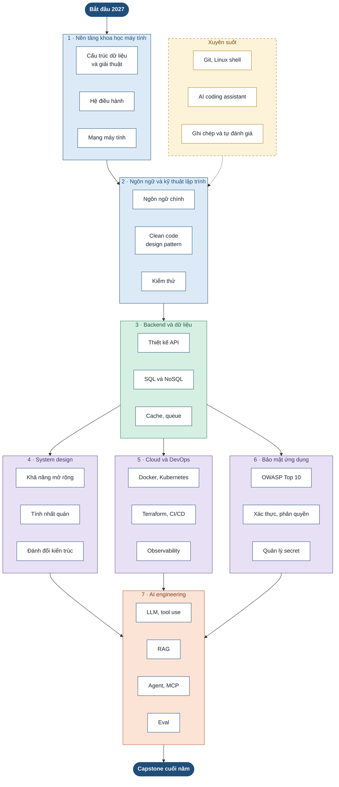

# Learning Software Engineer 2027

Repo này ghi lại lộ trình tự học kỹ sư phần mềm trong năm 2027. Lộ trình chia thành bảy nhóm kỹ năng, đi từ nền tảng khoa học máy tính tới AI engineering. Mỗi nhóm có kiến thức tiên quyết, danh sách nội dung để đánh dấu tiến độ và một project. Các project nối tiếp nhau trên cùng một sản phẩm, nên cuối năm repo có một hệ thống chạy được kèm ghi chép, đủ dùng làm portfolio khi phỏng vấn.

## 1. Sơ đồ roadmap

Học theo chiều mũi tên trong Hình 1. Sau nhóm 3, ba nhóm 4, 5 và 6 có thể học song song; khối "Xuyên suốt" được áp dụng ở mọi nhóm.



Hình 1. Roadmap bảy nhóm kỹ năng. Màu xanh dương là nền tảng, xanh lá là lõi backend, tím là các nhóm học song song, cam là AI engineering.

## 2. Mục tiêu

Mỗi mục tiêu gắn với một nhóm kỹ năng và có ngưỡng đạt để tự kiểm. Tất cả mục tiêu có hạn 31/12/2027.

| Mã | Nhóm | Mục tiêu | Ngưỡng đạt |
| --- | --- | --- | --- |
| G1 | 1 | Nắm vững cấu trúc dữ liệu và giải thuật | 150 bài tập có lời giải và phân tích độ phức tạp trong `01-cs-foundations/exercises/` |
| G2 | 2, 3 | Xây được một backend service hoàn chỉnh | Có API, database, test tự động, CI chạy xanh, test coverage từ 70% |
| G3 | 4 | Phân tích được thiết kế hệ thống | 5 bản thiết kế, mỗi bản có sơ đồ và bảng đánh đổi giữa các phương án |
| G4 | 5 | Deploy và vận hành service trên cloud | Service chạy trên cloud, có dashboard monitoring và ít nhất 1 runbook xử lý sự cố |
| G5 | 6 | Bảo vệ được service đã xây | Không còn lỗ hổng mức HIGH hoặc CRITICAL khi quét bằng Trivy; đã rà theo OWASP Top 10 |
| G6 | 7 | Xây tính năng có dùng LLM | Tính năng RAG hoặc agent chạy trong service, kèm bộ eval tự động từ 50 case |
| G7 | Xuyên suốt | Duy trì thói quen học đều | Ít nhất 1 commit ghi chép hoặc code trong 48/52 tuần |

## 3. Nhóm kỹ năng

Mỗi nhóm gồm ba phần: kiến thức tiên quyết, nội dung cần học và project. Đánh dấu ô chọn khi đã học xong và có ghi chép trong repo.

### 3.1 Nền tảng khoa học máy tính

Tiên quyết: không có.

- [ ] Cấu trúc dữ liệu: mảng, danh sách liên kết, stack, queue, hash table, cây, heap, đồ thị
- [ ] Giải thuật: sắp xếp, tìm kiếm, đệ quy, quy hoạch động, duyệt đồ thị
- [ ] Phân tích độ phức tạp thời gian và bộ nhớ
- [ ] Hệ điều hành: tiến trình, luồng, bộ nhớ ảo, hệ thống file, đồng bộ hóa
- [ ] Mạng máy tính: mô hình TCP/IP, HTTP/HTTPS, DNS, TLS

Project: một công cụ dòng lệnh (CLI) phân tích log, có test. Project này là điểm khởi đầu của sản phẩm xuyên suốt.

### 3.2 Ngôn ngữ và kỹ thuật lập trình

Tiên quyết: nhóm 1.

- [ ] Ngôn ngữ chính: cú pháp, hệ thống kiểu, xử lý lỗi, concurrency, quản lý package (xem mục 8)
- [ ] Clean code và refactoring
- [ ] Design pattern thường gặp
- [ ] Kiểm thử: unit test, integration test, test pyramid, mock

Project: viết lại CLI ở nhóm 1 bằng ngôn ngữ chính theo cấu trúc module rõ ràng, test coverage từ 70%.

### 3.3 Backend và dữ liệu

Tiên quyết: nhóm 2.

- [ ] Thiết kế API: REST, GraphQL, phân trang, versioning, xử lý lỗi
- [ ] SQL: mô hình dữ liệu, chỉ mục, transaction, mức cô lập
- [ ] Một hệ NoSQL để so sánh với SQL
- [ ] Cache và message queue
- [ ] Xác thực người dùng ở mức cơ bản

Project: chuyển CLI thành backend service có API, database và CI.

### 3.4 System design

Tiên quyết: nhóm 3.

- [ ] Khả năng mở rộng: scale dọc, scale ngang, cân bằng tải
- [ ] Dữ liệu phân tán: replication, partitioning, định lý CAP
- [ ] Tính nhất quán và xử lý lỗi: idempotency, retry, circuit breaker
- [ ] Ghi lại quyết định kiến trúc theo dạng Architecture Decision Record (ADR)

Project: 5 bản thiết kế cho các bài toán quen thuộc (rút gọn URL, chat, news feed, rate limiter, hệ thống thông báo), trong đó có một bản cho chính service ở nhóm 3.

### 3.5 Cloud và DevOps

Tiên quyết: nhóm 3.

- [ ] Container: Docker, Docker Compose
- [ ] Kubernetes ở mức deploy, scale và cấu hình
- [ ] Infrastructure as Code (IaC) với Terraform
- [ ] CI/CD: build, test, deploy, rollback
- [ ] Observability: metrics, log, tracing, cảnh báo

Project: deploy service lên cloud, kèm dashboard monitoring và runbook.

### 3.6 Bảo mật ứng dụng

Tiên quyết: nhóm 3.

- [ ] OWASP Top 10
- [ ] Xác thực và phân quyền: OAuth 2.0, OpenID Connect, JWT
- [ ] Quản lý secret và cấu hình
- [ ] Quét lỗ hổng dependency và container image

Project: rà soát bảo mật service, sửa lỗ hổng tìm được và ghi lại kết quả.

### 3.7 AI engineering

Tiên quyết: nhóm 3; nên xong nhóm 5 để deploy được.

- [ ] Nền tảng LLM: token, context window, prompt, structured output, tool use
- [ ] Retrieval-Augmented Generation (RAG): embedding, vector database, chunking, reranking
- [ ] Agent: vòng lặp tool use, Model Context Protocol (MCP), giới hạn chi phí và xử lý lỗi
- [ ] Eval: xây bộ eval, so sánh phiên bản prompt và model

Project: thêm tính năng hỏi đáp trên log bằng RAG hoặc agent vào service, kèm bộ eval.

### 3.8 Kỹ năng xuyên suốt

Các kỹ năng này không có thời điểm học riêng mà được dùng trong mọi nhóm.

- [ ] Git: branch, rebase, giải quyết xung đột, pull request
- [ ] Linux shell và viết script tự động hóa
- [ ] Làm việc với AI coding assistant: viết đặc tả rõ, review code do AI sinh, giữ chất lượng test
- [ ] Ghi chép sau mỗi chủ đề và tự đánh giá sau mỗi nhóm

Capstone cuối năm: tổng hợp sản phẩm qua bảy nhóm thành một bản demo, kèm bài viết mô tả kiến trúc và các bài học rút ra.

## 4. Toolkit

Toolkit gom các công cụ theo đúng bảy nhóm kỹ năng ở mục 3, mỗi nhóm giữ 1–2 công cụ chính. Công cụ phụ thuộc ngôn ngữ chính được chốt sau khi giải quyết mục 8.

| Nhóm | Công cụ | Mục đích |
| --- | --- | --- |
| Xuyên suốt | VS Code | Editor chính |
| Xuyên suốt | Git, GitHub | Quản lý phiên bản, lưu repo học tập |
| Xuyên suốt | Claude Code | AI coding assistant |
| 1. Nền tảng | `strace`, `htop`, `tcpdump` | Quan sát tiến trình, bộ nhớ và gói tin |
| 2. Lập trình | Ngôn ngữ chính, debugger, test framework | Viết code, tìm lỗi, kiểm thử; theo lựa chọn ở mục 8 |
| 3. Backend | PostgreSQL, Redis | Database quan hệ, cache và queue |
| 3. Backend | OpenAPI, Bruno | Đặc tả và gọi thử API |
| 4. System design | Excalidraw, Mermaid | Vẽ sơ đồ kiến trúc |
| 5. Cloud và DevOps | Docker, kind, Terraform | Đóng gói, chạy Kubernetes cục bộ, khai báo hạ tầng |
| 5. Cloud và DevOps | GitHub Actions, Prometheus, Grafana | CI/CD, metrics, dashboard và cảnh báo |
| 6. Bảo mật | Trivy, OWASP ZAP | Quét lỗ hổng image, dependency và ứng dụng web |
| 7. AI engineering | Claude API, pgvector, MCP SDK | Gọi LLM, lưu embedding, viết MCP server |

## 5. Cấu trúc repo

Mỗi nhóm kỹ năng một thư mục, đánh số theo sơ đồ ở mục 1. Thư mục được tạo khi bắt đầu nhóm tương ứng.

```text
.
├── README.md
├── 01-cs-foundations/
│   ├── notes/        # Ghi chép theo chủ đề
│   ├── exercises/    # Bài tập
│   └── project/      # Project của nhóm
├── 02-programming/
├── 03-backend-data/
├── 04-system-design/
├── 05-cloud-devops/
├── 06-security/
├── 07-ai-engineering/
├── capstone/
└── resources.md      # Tài liệu đã đọc, kèm ngày đọc
```

## 6. Quy ước làm việc

- Ghi chép viết bằng tiếng Việt; code, tên file và tên nhánh viết bằng tiếng Anh.
- Commit message theo Conventional Commits, scope là tên thư mục nhóm, ví dụ `feat(03-backend-data): add user login API`.
- Mỗi project có README riêng gồm: mục đích, cách chạy, cách test, các quyết định thiết kế chính.
- Xong mỗi nhóm, đánh dấu ô chọn ở mục 3 và viết một bản tự đánh giá ngắn so với mục tiêu ở mục 2.

## 7. Tài liệu tham khảo

| Nhóm | Tài liệu |
| --- | --- |
| Tổng quan | [roadmap.sh](https://roadmap.sh) |
| 1. Nền tảng | [CS50 (Harvard)](https://cs50.harvard.edu/x/), [NeetCode](https://neetcode.io), [Operating Systems: Three Easy Pieces](https://pages.cs.wisc.edu/~remzi/OSTEP/) |
| Xuyên suốt | [The Missing Semester of Your CS Education (MIT)](https://missing.csail.mit.edu/) |
| 3, 4. Backend và system design | Sách *Designing Data-Intensive Applications*, Martin Kleppmann; [System Design Primer](https://github.com/donnemartin/system-design-primer) |
| 6. Bảo mật | [OWASP Top 10](https://owasp.org/www-project-top-ten/) |
| 7. AI engineering | Sách *AI Engineering*, Chip Huyen |

## 8. Vấn đề mở

- [ ] Chọn ngôn ngữ lập trình chính cho cả năm (ví dụ Go, Java, Python hay TypeScript). Người quyết định: chủ repo.
- [ ] Xác định số giờ học mỗi tuần để kiểm tra các ngưỡng ở mục 2 có khả thi không. Người quyết định: chủ repo.
- [ ] Chọn nhà cung cấp cloud cho nhóm 5 (AWS, GCP hay Azure), tính cả chi phí free tier. Người quyết định: chủ repo.
