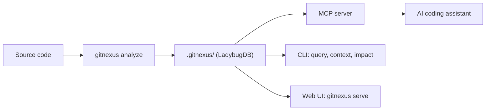

# 01. Tổng quan GitNexus

GitNexus biến một codebase thành knowledge graph gồm symbol, lời gọi hàm, phụ thuộc và luồng thực thi, rồi cung cấp graph đó cho AI agent qua MCP. Nhờ vậy agent trả lời được các câu hỏi như "ai gọi hàm này", "sửa hàm này ảnh hưởng tới đâu" mà không phải grep và đọc từng file. Việc index chạy cục bộ, không cần LLM; embedding, wiki và chat là tùy chọn.

## 1. Bài toán GitNexus giải quyết

AI coding assistant thường đọc code theo kiểu tìm chuỗi rồi mở file. Cách này bỏ sót lời gọi gián tiếp và không biết một thay đổi lan tới những luồng nào. GitNexus tính trước quan hệ giữa các symbol và lưu thành graph, nên agent hỏi graph thay vì đoán.

| Câu hỏi | Không có GitNexus | Có GitNexus |
| --- | --- | --- |
| Hàm `validateUser` được gọi ở đâu? | Grep tên hàm, đọc từng kết quả | `context` trả về danh sách caller và process |
| Sửa `validateUser` làm hỏng gì? | Đoán theo kinh nghiệm | `impact` liệt kê symbol bị ảnh hưởng theo độ sâu d=1, d=2, d=3 |
| Diff này chạm tới luồng nào? | Đọc diff rồi tự suy | `detect_changes` ánh xạ diff sang symbol, process và mức rủi ro |
| Đổi tên hàm an toàn không? | Find and replace | `rename` xem trước thay đổi trên nhiều file theo graph |

## 2. Cách GitNexus xây graph

Lệnh `gitnexus analyze` chạy sáu bước:

1. **Structure:** duyệt cây thư mục và file.
2. **Parsing:** dùng Tree-sitter dựng AST, trích function, class, method, interface.
3. **Resolution:** nối import và lời gọi giữa các file, kể cả kiểu của field và kiểu trả về.
4. **Clustering:** gom symbol thành các cộng đồng chức năng (community) bằng thuật toán Leiden.
5. **Processes:** lần theo luồng thực thi từ các entry point.
6. **Search:** dựng chỉ mục tìm kiếm lai BM25, semantic và RRF.

Kết quả lưu trong database LadybugDB (tên cũ KuzuDB) ở thư mục `.gitnexus/` của repo; thư mục này nằm trong `.gitignore`. Mỗi lần `analyze`, repo được đăng ký vào `~/.gitnexus/registry.json`, và một MCP server phục vụ mọi repo đã đăng ký.

Hình 1 tóm tắt luồng dữ liệu từ code tới agent.

Hình 1. Luồng dữ liệu của GitNexus.

## 3. Ngôn ngữ hỗ trợ

C, C++, C#, COBOL, Dart, Go, Java, JavaScript, Kotlin, Objective-C, PHP, Python, Ruby, Rust, Swift, TypeScript, Vue, Zig; R ở mức thử nghiệm. Mức hỗ trợ khác nhau theo từng cấu trúc ngôn ngữ, xem bài 05 về các trường hợp graph không nối được lời gọi.

## 4. Schema của graph

Graph có các loại node chính và một bảng cạnh chung `CodeRelation`, phân biệt bằng thuộc tính `type`.

| Loại | Giá trị |
| --- | --- |
| Node | File, Folder, Function, Class, Interface, Method, Community, Process, Route, Tool |
| Cạnh (`CodeRelation.type`) | CALLS, IMPORTS, EXTENDS, IMPLEMENTS, DEFINES, CONTAINS, MEMBER_OF, HAS_METHOD, STEP_IN_PROCESS, HANDLES_ROUTE, FETCHES |
| Cạnh chỉ có khi index với `--pdg` | CFG, CDG, REACHING_DEF, TAINTED, SANITIZES, TAINT_PATH |

Lớp **PDG** (program dependence graph) thêm node BasicBlock và các cạnh luồng điều khiển, luồng dữ liệu ở mức câu lệnh. Lớp này cần cho `pdg_query` và `explain`, nhưng làm thời gian index tăng khoảng 2–3 lần.

## 5. Ba cách dùng GitNexus

| Cách | Khi nào dùng |
| --- | --- |
| MCP tool trong AI coding assistant | Cách chính: agent tự gọi `query`, `context`, `impact` khi làm việc |
| CLI (`gitnexus query`, `gitnexus impact`) | Kiểm tra nhanh trên terminal, viết script, đối chiếu khi MCP trả kết quả lạ |
| Web UI (`gitnexus serve`, cổng 4747) | Xem graph trực quan khi tìm hiểu kiến trúc |

## Tự kiểm tra

- [ ] Giải thích được vì sao `impact` trả lời tốt hơn grep cho câu hỏi "sửa hàm này ảnh hưởng tới đâu".
- [ ] Kể được sáu bước của `analyze`.
- [ ] Biết index lưu ở đâu và registry lưu ở đâu.
- [ ] Biết khi nào cần `--pdg`.
