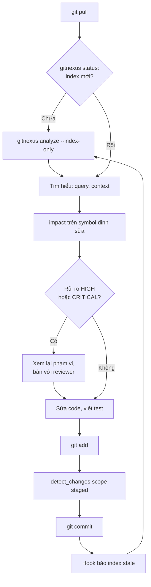

# 04. Tích hợp GitNexus vào workflow

Bài này đưa GitNexus vào các việc lặp lại hằng ngày: viết code, debug, refactor, review pull request và CI. Nguyên tắc xuyên suốt gồm hai bước: chạy `impact` trước khi sửa một symbol, chạy `detect_changes` trước khi commit. Phần cuối bài áp dụng các bước này cho project trong roadmap của repo.

## 1. Thiết lập một lần cho mỗi repo

1. Cài CLI và chạy `gitnexus setup` (bài 02).
2. Chạy `gitnexus analyze` lần đầu để sinh khối GitNexus trong `AGENTS.md`/`CLAUDE.md` và cài skill. Các lần sau dùng `--index-only` nếu đã sửa tay các file này.
3. Thêm `.gitnexusignore` nếu cần index thêm hoặc loại bớt thư mục.
4. Thêm quy tắc làm việc cho agent vào `CLAUDE.md` hoặc `AGENTS.md` (mục 2).
5. Kiểm tra hook PostToolUse đã được `setup` đăng ký (mục 7).

## 2. Quy tắc cho AI agent

Đặt khối dưới đây vào `CLAUDE.md` hoặc `AGENTS.md` để agent luôn làm theo cùng một quy trình:

```markdown
## GitNexus

- Trước khi sửa một function, class hoặc method: chạy `impact` (upstream) và báo phạm vi ảnh hưởng.
  Kết quả HIGH hoặc CRITICAL thì dừng lại hỏi trước khi sửa.
- Trước khi commit: chạy `detect_changes` với `scope: "staged"` và kiểm tra symbol, process bị ảnh hưởng.
- Đổi tên symbol: dùng `rename` (xem trước rồi mới áp dụng), không find and replace.
- Khi có nhiều repo đã index: luôn truyền `repo`.
- Kết quả UNKNOWN hoặc 0 caller: grep lại trước khi kết luận là an toàn.
- Index báo stale sau commit hoặc merge: chạy `gitnexus analyze --index-only` rồi mới truy vấn tiếp.
```

## 3. Vòng làm việc hằng ngày

Hình 1 mô tả vòng làm việc khi sửa code có GitNexus hỗ trợ.



Hình 1. Vòng làm việc hằng ngày với GitNexus.

## 4. Tìm hiểu và debug

**Tìm hiểu một phần code chưa quen:**

1. `list_repos`, rồi đọc `gitnexus://repo/{name}/context`.
2. `query` theo khái niệm, ví dụ "payment processing".
3. `context` trên các symbol chính trong kết quả.
4. Đọc resource `process/{name}` để thấy luồng từ đầu tới cuối.
5. Mở source để xác nhận.

**Debug một lỗi:**

1. `query` với thông báo lỗi hoặc triệu chứng.
2. `context` trên hàm nghi vấn để xem ai gọi và nó gọi ai.
3. `trace` để trả lời "A tới được B bằng đường nào"; không có đường thì node xa nhất cho biết chuỗi đứt ở đâu.
4. `detect_changes` với `scope: "compare"` và commit trước khi lỗi xuất hiện, để khoanh vùng regression.
5. `cypher` cho chuỗi quan hệ tùy biến.

## 5. Refactor

| Loại refactor | Quy trình |
| --- | --- |
| Đổi tên | `rename` xem trước, kiểm tra file, áp dụng với `plan_token`, `detect_changes`, chạy test |
| Tách hàm, tách module | `impact` trên symbol gốc; sửa theo thứ tự interface, implementation, caller, test |
| Di chuyển code | `impact` cả upstream lẫn downstream; sau khi chuyển chạy `check --cycles` để bắt import vòng |

## 6. Review pull request

Với PR lớn, review trên một worktree riêng có index riêng để không làm hỏng index của nhánh chính.

**Bước 1. Tạo worktree và index riêng:**

```bash
git fetch origin pull/<N>/head
git worktree add --detach ../review-pr<N> FETCH_HEAD
cd ../review-pr<N>
gitnexus analyze --index-only --force --name <repo>-pr<N>
```

Nếu repo chính có `.gitnexusignore` chưa commit, chép sang worktree trước khi index. MCP chỉ thấy repo mới sau khi log in "indexed successfully".

**Bước 2. Phân tích:**

1. Tính merge-base thay vì dùng nhánh đích trực tiếp: `git merge-base origin/main HEAD`. Dùng nhánh đích sẽ khiến thay đổi của các PR khác đã merge trông như bị đảo ngược.
2. `detect_changes` với `scope: "compare"`, `base_ref: <merge-base>`, `repo: "<repo>-pr<N>"`.
3. `impact` upstream trên từng symbol thay đổi, chú ý symbol d=1 nằm ngoài diff.
4. `context` để xem caller; `pdg_query` với `mode: "controls"` để kiểm tra điều kiện bảo vệ (cần `--pdg`).
5. Chứng minh phát hiện bằng test thật: sửa ngược dòng vừa vá rồi kiểm tra test chuyển đỏ.

**Bước 3. Vòng review tiếp theo:** `git checkout --detach <head-mới>` trong worktree, chạy lại `analyze --force --name <repo>-pr<N>`, rồi `detect_changes` với `base_ref` là head của vòng trước.

**Bước 4. Dọn dẹp:**

```bash
cd ../review-pr<N> && gitnexus clean -f
cd - && git worktree remove --force ../review-pr<N> && git worktree prune
```

Lưu ý khi review:

- PR nhỏ, một khu vực: dùng `detect_changes` với tham số `worktree` trên index chính là đủ.
- PR chỉ sửa cấu hình (Dockerfile, YAML CI, nginx) gần như không có trong graph; bằng chứng phải đến từ chạy thử.
- Kết quả `detect_changes` lớn (trên khoảng 50 KB) được ghi ra file; `truncated: true` nghĩa là chưa kiểm hết, phải đọc tay phần còn lại.
- Không index lại checkout chính khi đang review: dùng `--name` riêng để giữ nguyên cấu hình index của nhánh chính.

## 7. Hook trong Claude Code

`gitnexus setup` đăng ký hai hook cho Claude Code:

| Hook | Khi nào chạy | Tác dụng |
| --- | --- | --- |
| PreToolUse (Grep, Glob, Bash) | Trước khi agent tìm kiếm | Bổ sung ngữ cảnh từ graph vào kết quả tìm |
| PostToolUse (Bash) | Sau `git commit`, `merge`, `rebase`, `cherry-pick`, `pull` | So HEAD với commit đã index, báo agent index đã cũ và lệnh cần chạy |

Hook PostToolUse chỉ báo, không tự chạy `analyze`, vì `analyze` có thể chặn agent tới 120 giây và dễ làm hỏng database nếu bị ngắt giữa chừng.

## 8. Pipeline plan, work, review

Bộ skill GitNexus cho Claude Code nối các bước thành một pipeline:

| Skill | Việc làm |
| --- | --- |
| `gitnexus-plan` | Hỏi độ sâu (Quick, Standard, Deep), dựng kế hoạch từ graph, lưu vào `docs/plans/YYYY-MM-DD-gitnexus-plan-<slug>.md` |
| `gitnexus-work` | Thực hiện từng bước: `impact` trước mỗi lần sửa symbol, `detect_changes` với `scope: "staged"` trước mỗi commit, mỗi bước một commit |
| `gitnexus-review` | Review PR, nhánh hoặc thay đổi cục bộ; kết luận APPROVE, REQUEST CHANGES hoặc NEEDS DISCUSSION |
| `gitnexus-lfg` | Chạy cả ba: plan, chờ người dùng duyệt, work, review; không tự push hay mở PR |

Gọi trong Claude Code, ví dụ: `/gitnexus-plan Thêm retry cho module gửi email`.

## 9. Pre-commit và CI

Phần này là đề xuất, chưa chạy thử trên CI thật. Tài liệu GitNexus chưa có GitHub Action chính thức.

**Git pre-commit hook** chặn commit tạo import vòng:

```bash
# .git/hooks/pre-commit
#!/usr/bin/env bash
set -e
gitnexus check --cycles
```

**GitHub Actions** chạy kiểm tra cấu trúc và in phạm vi thay đổi của PR:

```yaml
# .github/workflows/gitnexus.yml
name: gitnexus
on: pull_request
jobs:
  analyze:
    runs-on: ubuntu-latest
    steps:
      - uses: actions/checkout@v4
        with:
          fetch-depth: 0
      - uses: actions/setup-node@v4
        with:
          node-version: 22
      - run: npm install -g gitnexus@1.6.10
      - run: gitnexus analyze --index-only
      - run: gitnexus check --cycles
      - run: gitnexus detect-changes -s compare -b origin/${{ github.base_ref }}
```

Cần cân nhắc trước khi bật trên CI:

- Index repo lớn mất nhiều phút cho mỗi lần chạy.
- GitNexus dùng giấy phép PolyForm Noncommercial; repo thương mại cần license riêng.
- Biến môi trường `CI` làm GitNexus bỏ qua bước kiểm tra phiên bản mới.

## 10. Chạy `analyze` dài trong nền

Với repo lớn, `analyze` có thể vượt giới hạn thời gian của tool Bash trong agent (khoảng 10 phút). Tách hẳn tiến trình:

```bash
setsid nohup bash -c 'gitnexus analyze --force --index-only > /tmp/idx.log 2>&1; echo ANALYZE_RC=$?' < /dev/null & disown
until grep -q ANALYZE_RC /tmp/idx.log; do sleep 10; done
grep -i fts /tmp/idx.log    # kiểm tra lỗi chỉ mục full-text
```

Chỉ chạy một `analyze` tại một thời điểm, và không sửa file trong worktree khi `analyze` đang đọc.

## 11. Áp dụng cho roadmap của repo này

| Nhóm kỹ năng | Cách dùng GitNexus |
| --- | --- |
| 2. Lập trình | Index project CLI, dùng `context` và `impact` khi refactor; `check --cycles` giữ module sạch |
| 3. Backend | `route_map`, `api_impact`, `shape_check` khi sửa API |
| 4. System design | Dùng community và process để vẽ lại kiến trúc thực tế, so với bản thiết kế |
| 6. Bảo mật | Index với `--pdg`, dùng `explain` tìm luồng taint, `pdg_query` kiểm tra điều kiện bảo vệ |
| 7. AI engineering | Dùng chính GitNexus làm ví dụ về MCP server và công cụ cho agent |

## Tự kiểm tra

- [ ] Repo thực hành có khối quy tắc GitNexus trong `CLAUDE.md` hoặc `AGENTS.md`.
- [ ] Làm được vòng ở Hình 1 cho một thay đổi thật.
- [ ] Review được một PR bằng worktree và index riêng, rồi dọn sạch.
- [ ] Giải thích được vì sao hook PostToolUse không tự chạy `analyze`.
